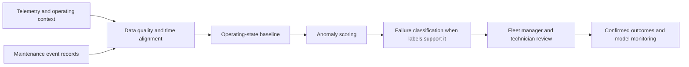

# Electric Fleet Predictive Maintenance Strategy

**Feras Elghandour** · ML product strategy, fleet reliability, and pilot economics

Unplanned component failures can disrupt a commercial electric fleet and make maintenance budgets unpredictable. This case proposes a telemetry-to-maintenance workflow that identifies unusual operating behavior and turns it into reviewable service recommendations.

## Proposed system



The strategy combines anomaly detection with a supervised failure classifier when enough labeled events exist. Inputs include component telemetry, work orders, and operating conditions. A fleet dashboard would show component risk, supporting signals, and service recommendations. Remaining useful life requires a separately validated model; anomaly scores alone do not establish days to failure.

## Scope and evidence

This is an ML product strategy and economics case, with an executable scenario calculator. It contains no trained fleet model, customer telemetry, deployment, or realized savings. The source proposal targets **30% fewer reactive incidents within 18 months** and **under $800 per planned intervention**; these are planning hypotheses, not measured results.

The [MetroPT dataset paper](https://doi.org/10.1038/s41597-022-01877-3) provides a research reference for sensor-based predictive maintenance. Its railway compressor setting does not establish electric-truck model performance. [The pilot plan](PILOT_PLAN.md) explains how to test transferability and business value.

## Reproduce the economics

Python 3.11 or later; standard library only:

```sh
python -m unittest discover -s tests -v
```

`annual_net_benefit(100, 5000, .3, 50, 800, 50000)` calculates **$60,000/year** under a synthetic scenario: 100 baseline incidents, $5,000 loss each, 30% avoided, 50 planned interventions at $800, and $50,000 platform cost. The break-even avoided fraction is **18%**. Inputs are illustrative assumptions and exclude indirect costs. Five tests cover arithmetic, break-even, negative outcomes, invalid fractions, and an absent baseline.

## Practical relevance

The project connects an ML proposal to fleet decisions, technician workload, evidence requirements, and an explicit cost model. Deployment decisions must depend on event-level validation and a controlled pilot. Safety-critical maintenance schedules remain under qualified human control.
